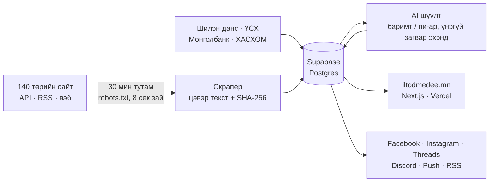

<p align="center">
  <a href="https://iltodmedee.mn">
    <picture>
      <source media="(prefers-color-scheme: dark)" srcset="docs/readme/banner-dark.jpg">
      
    </picture>
  </a>
</p>

<p align="center">
  <a href="https://iltodmedee.mn">
    <picture>
      <source media="(prefers-color-scheme: dark)" srcset="https://readme-typing-svg.demolab.com?font=Inter&weight=500&size=22&duration=3000&pause=1200&color=5CC8C1&center=true&vCenter=true&width=640&height=44&lines=%D0%A2%D3%A9%D1%80%D0%B8%D0%B9%D0%BD+%D0%BC%D1%8D%D0%B4%D1%8D%D1%8D%2C+%D0%BF%D0%B8-%D0%B0%D1%80%D0%B3%D2%AF%D0%B9;140+%D1%82%D3%A9%D1%80%D0%B8%D0%B9%D0%BD+%D1%8D%D1%85+%D1%81%D1%83%D1%80%D0%B2%D0%B0%D0%BB%D0%B6%2C+30+%D0%BC%D0%B8%D0%BD%D1%83%D1%82+%D1%82%D1%83%D1%82%D0%B0%D0%BC;%D0%A2%D3%A9%D1%81%D3%A9%D0%B2+%C2%B7+%D0%A2%D0%B5%D0%BD%D0%B4%D0%B5%D1%80+%C2%B7+%D0%A2%D0%B0%D1%82%D0%B2%D0%B0%D1%80+%C2%B7+%D0%A3%D0%BB%D1%81%D1%82%D3%A9%D1%80%D1%87%D0%B8%D0%B4;%D0%91%D0%B0%D1%80%D0%B8%D0%BC%D1%82+%D0%B1%D2%AF%D1%80+%D1%8D%D1%85+%D1%81%D1%83%D1%80%D0%B2%D0%B0%D0%BB%D0%B6%D1%82%D0%B0%D0%B9">
      
    </picture>
  </a>
</p>

<p align="center">
  <a href="https://iltodmedee.mn"></a>
  <a href="https://www.facebook.com/profile.php?id=61595785044734"></a>
  <a href="https://www.instagram.com/iltodmedee.mn/"></a>
  <a href="https://www.threads.com/@iltodmedee.mn"></a>
  <a href="https://discord.gg/zSW5FbWRrZ"></a>
  <a href="https://iltodmedee.mn/feed.xml"></a>
</p>

<p align="center">
  <a href="https://github.com/iltodmedee-mn/UNENMEDEE/actions/workflows/ci.yml"></a>
  <a href="https://github.com/iltodmedee-mn/UNENMEDEE/actions/workflows/autonomous-news-pipeline.yml"></a>
  <a href="LICENSE"></a>
  <a href="LICENSE-CONTENT.md"></a>
</p>

<p align="center">
  🇲🇳 Монгол Улсын төрийн байгууллагуудын албан ёсны мэдээ, хууль, төсөв, тендер, улстөрчдийн хөрөнгийн мэдүүлгийг автоматаар цуглуулж, <b>баримтыг пи-араас салгадаг</b>, зарцуулсан цент бүрээ ил тайлагнадаг нээлттэй эхийн мэдээллийн сайт.<br>
  🇬🇧 An open-source news site that collects official news, laws, budgets, tenders and MPs' asset declarations from Mongolian government websites, <b>separates verifiable facts from PR spin</b>, and publishes every cent it spends. <a href="#english">English below</a>.
</p>

<p align="center">
  <a href="https://iltodmedee.mn"></a>
</p>
<p align="center">
  <a href="https://iltodmedee.mn"></a>
</p>

---

## 01 — Сайт дээр юу байна

<table>
<tr>
<td width="50%" valign="top">

**📰 Мэдээ**

- [Нүүр](https://iltodmedee.mn): өнөөдрийн мэдээ, AI хураангуй, «Танд хамаатай юу?»
- [Онцлох тойм](https://iltodmedee.mn/digest): өдөрт 2 удаа, 10 гол мэдээ
- [Миний мэдээ](https://iltodmedee.mn/my): дагасан сэдэв, аймаг
- [Хууль](https://iltodmedee.mn/laws): шинэ хууль, тогтоол
- [Эрсдэл](https://iltodmedee.mn/risk): AI-ийн үнэлгээ, буруутгал биш
- [Олон эх сурвалж](https://iltodmedee.mn/clusters): нэг мэдээг олон сайт бичсэн
- [Өөрчлөлт](https://iltodmedee.mn/changes): төрийн сайт засварласан, устгасан мэдээ
- [Архив](https://iltodmedee.mn/archive): өдөр бүрийн мэдээ
- [Нэр томьёо](https://iltodmedee.mn/glossary): тогтоол, тодотгол гэж юу вэ

</td>
<td width="50%" valign="top">

**💰 Мөнгө, тоо**

- [Төсөв](https://iltodmedee.mn/budget): улсын орлого, зарлага 1990 оноос, өр, аудит
- [Миний татвар](https://iltodmedee.mn/tax): цалингийн ХХОАТ, НДШ, 2027–2028 оны өөрчлөлт
- [Үнэ](https://iltodmedee.mn/prices): мах, бензин 1, 5, 10, 15 жилийн өмнө (ҮСХ)
- [Тендер](https://iltodmedee.mn/tenders): хэн, юуг, хэдээр (Шилэн данс), анхаарах шинж
- [Тайлан, баримт](https://iltodmedee.mn/documents): аудитын шинэ тайлан, тендерийн баримт
- [Өгөгдөл](https://iltodmedee.mn/data): ханш, инфляц, бодлогын хүү, opendata.mn

</td>
</tr>
<tr>
<td width="50%" valign="top">

**🏛️ Төр, улстөрчид**

- [Улстөрчид](https://iltodmedee.mn/officials): УИХ-ын гишүүдийн хөрөнгө, орлого, ирц, «Миний гишүүн»
- [Амлалт](https://iltodmedee.mn/promises): Засгийн газрын 620 зорилт, эх текстээр
- [Төслүүд](https://iltodmedee.mn/projects): том төсөл хэдэн жил, хэдэн ₮
- [Төрийн компани](https://iltodmedee.mn/officials/companies): орлого, ашиг, цалингийн сан
- [Миний аймаг](https://iltodmedee.mn/topic/local#places): 21 аймаг, 9 дүүрэг
- [Оролцох](https://iltodmedee.mn/participate): УИХ-д өгсөн нээлттэй өргөдөл
- [Мэдээлэл хүсэх](https://iltodmedee.mn/request): төрөөс мэдээлэл авах захидал
- [Эх сурвалж](https://iltodmedee.mn/sources): хянаж буй 140 төрийн сайт

</td>
<td width="50%" valign="top">

**🔎 Бидний тухай**

- [Бид хэн бэ](https://iltodmedee.mn/about): хэн, яагаад ажиллуулдаг
- [Арга зүй](https://iltodmedee.mn/method): AI яаж ажилладаг, AI-д өгдөг заавар бүтнээрээ
- [Ил тод тайлан](https://iltodmedee.mn/transparency): AI дуудлага бүрийн зардал, хандив
- [Нууцлал](https://iltodmedee.mn/privacy): ямар мэдээлэл хадгалдаг
- [Дэмжих](https://iltodmedee.mn/support): хандив юунд зарцуулагддаг

**📲 Дагах**

[Facebook](https://www.facebook.com/profile.php?id=61595785044734) · [Instagram @iltodmedee.mn](https://www.instagram.com/iltodmedee.mn/) · [Threads @iltodmedee.mn](https://www.threads.com/@iltodmedee.mn) · [Discord](https://iltodmedee.mn/discord) · [RSS](https://iltodmedee.mn/feed.xml) · сайт дээрх 🔔 мэдэгдэл

Өдөр бүр 2 богино видео (Reels), өдөрт 2 тойм, ням гаригт «7 хоногийн тест».

</td>
</tr>
</table>

## 02 — Яаж ажилладаг вэ



<p align="center">
  <picture>
    <source media="(prefers-color-scheme: dark)" srcset="https://skillicons.dev/icons?i=nextjs,react,ts,tailwind,nodejs,postgres,supabase,vercel,githubactions&theme=dark">
    
  </picture>
</p>

Сайтыг ажиллуулдаг бүх зүйл энэ репод байна: вэб сайт (Next.js), 140 төрийн сайтаас 30 минут тутам мэдээ цуглуулагч, AI шинжилгээ ба AI-д өгдөг заавар ([`src/lib/ai/prompts.ts`](src/lib/ai/prompts.ts)), бүх автомат ажил ([`.github/workflows/`](.github/workflows)). Тэдгээрийн бүртгэл [Actions](https://github.com/iltodmedee-mn/UNENMEDEE/actions) хэсэгт нээлттэй.

📐 **Техникийн дэлгэрэнгүй:** [docs/ARCHITECTURE.md](docs/ARCHITECTURE.md): систем, өгөгдлийн сан, скрапер, AI pipeline, кластерчлал, аюулгүй байдал, шийдвэрүүдийн шалтгаан (англиар).

## 03 — Үндсэн зарчим

- **Баримт эхэнд.** Тоо, ₮ дүн, огноо, хууль, байгууллагыг пи-ар, магтаалаас тусад нь гаргана.
- **Нотлох боломжтой.** Мэдээ бүр эх `.gov.mn` холбоос, цэвэрлэсэн эх текстийн SHA-256 хэштэй.
- **Хэнийг ч буруутгахгүй.** Улстөрчид, төсвийн мэдээлэлд зөвхөн албан ёсны бүртгэлийг эх сурвалжийн холбоостой харуулна. AI-д хүнийг гэмт хэрэгт буруутгахыг хориглосон.
- **Эрсдэлийн оноо = AI-ийн үнэлгээ, баримт биш.** Яаж гардгийг [/method](https://iltodmedee.mn/method) хуудсанд AI-ийн зааврын хамт бүтнээр нь нийтэлсэн.
- **Зар сурталчилгаагүй, хувь хүнийг мөрдөхгүй.** Уншсан мэдээ, дагасан гишүүн зөвхөн таны төхөөрөмжид хадгалагдана. Хандалтыг зөвхөн нэргүй нийт тоогоор (Vercel Web Analytics, cookie-гүй) хэмждэг.
- **0₮ дэд бүтэц.** Vercel Hobby, Supabase Free, GitHub Actions. Төлбөртэй AI сард $3-оос хэтрэхгүй.

## 04 — AI түлхүүр яаж хадгалагддаг вэ

- Кодонд **ямар ч түлхүүр, нууц үг байхгүй**. AI-ийн түлхүүр, `DATABASE_URL` зөвхөн GitHub Actions secrets болон Vercel-ийн орчны хувьсагчид байна. `.env*` файлууд git-д ордоггүй (`.env.example` л байна).
- Үнэгүй AI-ууд (Groq, NVIDIA NIM, Requesty, OpenRouter) ээлжлэн ажиллана, дараа нь Z.ai. Gemini: төлбөр холбоогүй Google project-ийн түлхүүр бол үнэгүй (`GEMINI_FREE_TIER=true`); төлбөртэй түлхүүр бол үнэгүйнүүдийн дараа, зөвхөн хамгийн хямд `gemini-3.1-flash-lite` загвараар, мөнгөний хязгаар дотор. Зураг үүсгэх загвар хэзээ ч ашиглахгүй. Төлбөртэй (DeepSeek, Grok) нь сард `AI_MONTHLY_BUDGET_USD` ($3), өдөрт `AI_DAILY_BUDGET_USD` ($0.30)-оос хэтэрвэл автоматаар зогсоно ([`src/lib/ai/limits.ts`](src/lib/ai/limits.ts)).
- Дуудлага бүр `ai_usage_logs`-д бичигдэж [/transparency](https://iltodmedee.mn/transparency)-д харагдана.

## 05 — Өөрийн компьютер дээр ажиллуулах

```bash
git clone https://github.com/iltodmedee-mn/UNENMEDEE && cd UNENMEDEE
npm install                 # Node.js 24
npm run demo                # http://localhost:3000: жишээ өгөгдөлтэй бүтэн сайт, DB болон API түлхүүр хэрэггүй
```

`npm run demo` нь `tests/fixtures`-д хадгалсан **бодит** төрийн мэдээ, УИХ-ын гишүүд, ХАСХОМ мэдүүлэг, Монголбанк, төсөв, тендерийн өгөгдлийг процесс доторх Postgres (PGlite, `.demo-db/`) руу ачаалж сайтыг асаана. Хураангуй нь эхний өгүүлбэрүүд ("AI ажиллаагүй"); `.env`-д үнэгүй `GROQ_API_KEY` тавиад `DATABASE_URL=pglite:./.demo-db npm run ai:process` хийвэл AI хураангуй үүснэ. Дахин эхнээс нь: `.demo-db/`-г устгана.

Өгөгдөлтэй ажиллуулах:

```bash
cp .env.example .env        # DATABASE_URL, нэг үнэгүй AI түлхүүр (GROQ_API_KEY), ADMIN_SECRET_PASSWORD
npm run db:migrate && npm run db:seed
npm run scrape -- --source mlsp.gov.mn --limit 2
npm run ai:process -- --limit 2
```

API түлхүүрээ шалгах: `npm run ai:process -- --sample`. Өгөгдлийн сангүй туршилт: `npm run scrape -- --dry-run --source parliament.mn --limit 2`.

**`DATABASE_URL`:** Supabase төсөл → **Connect** → **Transaction pooler** (порт 6543). Migration-д **Session pooler** (порт 5432)-ийг `DATABASE_URL_DIRECT` нэрээр нэмж болно.

**Автоматжуулалт:** репо → Settings → Secrets and variables → Actions хэсэгт `DATABASE_URL` болон дор хаяж нэг AI түлхүүр нэмэхэд мэдээ 30 минут тутам шинэчлэгдэнэ. Vercel дээр мөн адил (нэмээд `ADMIN_SECRET_PASSWORD`, 12+ тэмдэгт).

## 06 — Хувь нэмэр оруулах

- **Эх сурвалж санал болгох:** [issue нээх](https://github.com/iltodmedee-mn/UNENMEDEE/issues/new/choose) → "Эх сурвалж санал болгох". Эсвэл [`src/lib/sources.ts`](src/lib/sources.ts)-д нэмээд PR илгээнэ. JSON API-тай сайтад [`src/lib/scraper/adapters/`](src/lib/scraper/adapters)-д adapter бичнэ.
- **Алдаа мэдэгдэх:** AI хураангуй, тоо буруу байвал эх сурвалжийн холбоосыг хавсаргаад issue нээнэ үү.
- **Код:** PR бүр `npm run check` (typecheck + lint + 670+ unit test) болон `npm run build` (нууц түлхүүргүй) давах ёстой. Алхам алхмаар заавар: [CONTRIBUTING.md](CONTRIBUTING.md). Архитектурын дүрэм [`CLAUDE.md`](CLAUDE.md)-д бий.

## 07 — Эзэмшигчийн шалгах хуудас

Сайт хүнгүйгээр ажиллана: мэдээ 30 минут тутам, тойм өдөрт хоёр удаа, видео өдөрт хоёр, УИХ-ын гишүүд долоо хоног бүр, сонгуулийн дараа ч өөрөө шинэчлэгдэнэ. Ямар нэг зүйл зогсвол **watchdog** GitHub issue нээж танд имэйл илгээнэ: мөр бүр юу зогссон, аль secret/хуудсыг засахыг хэлнэ. Татварын хууль өөрчлөгдсөн байж магадгүй мэдээ гарвал тусдаа `tax-rates` issue нээгдэнэ. Хүний гар шаардлагатай цорын ганц зүйлс:

| Хэзээ | Юу хийх |
|---|---|
| Одоо, нэг удаа | /admin-д «Бид хэн бэ» хуудасны «Хэн ажиллуулдаг вэ» хэсгийг бичих. Чатад хуулсан Vercel токеныг хүчингүй болгох. `main` ruleset-д `mobile-layout`-ыг заавал шалгах болгох. Settings → General: «Allow auto-merge», Settings → Actions: «Allow GitHub Actions to create and approve pull requests». Settings → General → Social preview-д [`docs/readme/social-preview.jpg`](docs/readme/social-preview.jpg)-г оруулах. |
| Watchdog issue ирэхэд | 🔴 яаралтай бол тэр өдөртөө, 🟡 бол завтай үедээ. Мөр бүрт юу хийхийг [docs/RUNBOOK.md](docs/RUNBOOK.md) (Claude-гүй үеийн гарын авлага) хэлнэ. Засагдмагц issue өөрөө хаагдана. |
| `tax-rates` issue ирэхэд | Мэдээ, эх хуулийг уншаад өөрчлөгдсөн бол `src/lib/tax/receipt.ts`-д шинэ шатлалыг нэмж, `RATES_CHECKED`-ийг шинэчлэх. Issue өөрөө хаагдана. |
| Сар бүр | /admin-д ирсэн хандив, сарын орлогыг оруулах: оруулаагүй сар «бүртгээгүй» гэж харагдана. |
| Улиралд нэг удаа | Нөөц хуулбарыг нэг удаа тайлж шалгах ([docs/BACKUP.md](docs/BACKUP.md), 3-р алхам). Dependabot-ын жижиг шинэчлэл CI ногоон бол өөрөө нэгтгэгдэнэ; том (major) шинэчлэлийг [docs/RUNBOOK.md](docs/RUNBOOK.md) §4-ийн дагуу. |
| Жил бүр | Porkbun домэйн сунгалт. Meta Data Use Checkup. `VERCEL_TOKEN`-ийг шинэчлэх. Watchdog сануулбал `POPULATION`, `RATES_CHECKED`, `GOVERNMENTS_VERIFIED_THROUGH`-ийг шинэчлэх. |
| Засгийн газар солигдоход | `src/lib/budget/governments.ts`-д шинэ Ерөнхий сайдыг нэмж `GOVERNMENTS_VERIFIED_THROUGH`-ийг шилжүүлэх. Түүнээс өмнө /budget шинэ онд «—» гэж үнэнээр нь харуулна. |
| 2027-10 | audit.mn-ийн `certs/rapidssl-tls-rsa-ca-g1.pem` 2027-11-02-нд дуусна (watchdog 60 хоногийн өмнө сануулна). Pipeline-ийн нөөц GitHub токен 2027-10-29-нд дуусна ([docs/PIPELINE-FALLBACK.md](docs/PIPELINE-FALLBACK.md)). |
| 2028-04 | Node 24-ийн дэмжлэг дуусна: workflow-ууд болон Vercel дээр `node-version`-ийг ахиулах. |
| 2028-06 УИХ-ын сонгууль | Юу ч хийх шаардлагагүй: шинэ гишүүд дараагийн sync-ээр орж, тойргийн нэр өөрчлөгдсөн ч аймгийн хуудсууд гишүүдээ олно. Watchdog идэвхтэй гишүүн 100-аас цөөн эсвэл гишүүнгүй аймаг гарвал хэлнэ. |
| 2028-07 | Шинэ Засгийн газрын хөтөлбөр батлагдсаны дараа `npm run promises:import`. Тэр хүртэл /promises «өмнөх хөтөлбөр» гэж бичнэ. |
| Supabase төсөл алдагдвал | Шинэ төсөл → secret-ууд → `db:migrate` → `db:restore` ([docs/BACKUP.md](docs/BACKUP.md)). VAPID түлхүүрийг хэзээ ч шинээр бүү үүсгэ. |
| Сошиал токен дуусвал | Шинэ токеныг secret-д хийхэд хадгалагдсан токеныг өөрөө солино ([docs/FACEBOOK.md](docs/FACEBOOK.md)). |

## 08 — Холбоо барих

Сайттай холбоотой санал хүсэлт, алдаа, шинэ эх сурвалж, хамтын ажиллагаа, хэвлэл мэдээллийн асуудлаар **[info@iltodmedee.mn](mailto:info@iltodmedee.mn)** хаягаар бичээрэй. Кодын алдаа, санааг [issue](https://github.com/iltodmedee-mn/UNENMEDEE/issues) болгон нээж болно.

## 09 — Аюулгүй байдал

Эмзэг байдал олвол **нээлттэй issue бүү бичээрэй**: [SECURITY.md](SECURITY.md)-ийн дагуу нууцаар мэдэгдэнэ үү.

- `main` салбар хамгаалагдсан: зөвхөн PR-ээр, CI ногоон үед нэгтгэнэ.
- GitHub Actions-ууд commit SHA-аар бэхлэгдсэн, `GITHUB_TOKEN` анхдагчаар зөвхөн уншина.
- Dependabot долоо хоног бүр шинэчлэл санал болгоно. CodeQL, secret scanning, push protection асаалттай.
- Аюулын загвар (threat model): нэг DB хэрэглэгч яагаад хангалттай, админ хамгаалалт, prompt injection-оос хамгаалах арга. Дэлгэрэнгүйг [SECURITY.md](SECURITY.md)-с үзнэ үү.

---

<a id="english"></a>

## English

### How it works

The full technical write-up, with diagrams, the data model, algorithms and design trade-offs, is in **[docs/ARCHITECTURE.md](docs/ARCHITECTURE.md)**. A short version:

```
GitHub Actions (every 30 min: four crons, plus a pg_cron fallback that dispatches the run if none started for an hour)
 ├─ npm run scrape          140 sources (curated + discovered), least-recently-scraped first, time budget
 │   ├─ JSON APIs / feeds   opendata.gov.mn, parliament.mn, legalinfo.mn, police.gov.mn, www.gov.mn, mongolia.gov.mn RSS
 │   ├─ HTTP pass (Crawlee) robots.txt (8 hosts at a time) → WordPress REST API → RSS → link harvesting → Readability
 │   └─ Browser pass        headless Chromium only for JavaScript-rendered sites
 │      → SHA-256 dedup → clean text only → articles
 ├─ npm run ai:process
 │   ├─ Budget guard                            paid providers stop at $3/month, $0.30/day; Grok ≤ 5 calls/day
 │   ├─ Tier 1  4 free providers in turn → Z.ai → Gemini → DeepSeek   facts, spin, risk 0-100, plain headline, "who does it affect"
 │   ├─ Tier 2  Grok → Gemini → Groq → …        only when risk ≥ 65: investigative analysis
 │   ├─ Fallback                                first sentences if every provider fails for 24 h
 │   └─ ai_usage_logs                           exact tokens and USD for every call
 ├─ press:sync, push:send, due digest          press headlines matched to our stories, Web Push, AI news digest
 └─ video:make, social:post                     a 30-second news video in each daily slot → Facebook / Instagram Reels, Threads;
                                                news and digests → Facebook, Instagram, Threads, Discord (Telegram when set up);
                                                Sunday quiz carousel → Facebook, Instagram, Threads
GitHub Actions (08:07 and 20:07 Ulaanbaatar)
 ├─ data / macro / budget / tenders / petitions sync   opendata.mn, Mongolbank, NSO, Шилэн данс (budget + form 1831 tenders), World Bank, audit.mn, petition.parliament.mn
 ├─ docs:watch                             new audit.mn reports and files on watched report / tender pages
 └─ db:prune                               old bodies → excerpts, old unpublished rows deleted (bounded DB)
Weekly: officials:sync (MPs + ХАСХОМ declarations, declared companies), sources:discover, sources:recheck (edited or deleted posts), encrypted backup.
Daily: watchdog (GitHub issues, incl. a "tax-rates" issue when a story may change the /tax rates), keepalive, Vercel deployment cleanup.
Vercel (Next.js 16, Cache Components) reads Supabase and renders the public site + /admin.
```

### Repository map

| Path | What |
|---|---|
| `CLAUDE.md` | Architecture rules for contributors and AI agents |
| `src/db/schema.ts`, `drizzle/` | Drizzle schema and SQL migrations |
| `src/lib/sources.ts` | Curated source list and discovery hubs |
| `src/lib/scraper/` | robots.txt parser, polite fetch (8 s per host), extractor, adapters, two-pass crawler, source re-check |
| `src/lib/ai/` | Provider router with cost logging, budget guard, prompts, schemas, clustering, digest, reader view |
| `src/lib/officials/`, `budget/`, `procurement/`, `documents/`, `participation/`, `soe/`, `mongolbank/`, `opendata-mn/` | Civic-data clients and parsers (each unit-tested on saved fixtures) |
| `src/lib/tax/`, `src/lib/promises/`, `src/lib/projects/`, `src/lib/places.ts` | Tax calculator and rate watch, the Government programme, mega projects, aimags and constituencies |
| `src/lib/queries.ts` | Cached read model for the public site |
| `src/lib/social/`, `src/lib/video/` | Facebook, Instagram, Threads, Telegram and Discord posting, quizzes, the Messenger and Discord bots; the daily videos (voice, frames, ffmpeg) |
| `src/lib/seo.ts`, `src/lib/structured-data.ts`, `src/lib/archive.ts` | Which pages are indexed, JSON-LD builders, the day archive |
| `src/app/` | Pages (see the grid above) and `/admin` |
| `.github/workflows/` | Pipeline, digest + data sync, officials, discovery, source re-check, social posts, video, watchdog, keepalive, backup, Vercel cleanup, maintenance, CI |

### Audit it yourself

- **Every number on `/transparency` comes from SQL.** `ai_usage_logs` stores provider, model, tokens and the USD cost from the public price table in `src/lib/ai/pricing.ts`.
- **Every article links to its `.gov.mn` original** and shows the SHA-256 of the cleaned text. Edits are labelled on the page; the hash keeps proving the original scrape.
- **The prompts are public**, both in `src/lib/ai/prompts.ts` and rendered verbatim on `/method`.
- **Risk scores are AI estimates, not facts.** The model scores 0-100 by the published rubric; our code, not the model, sets the "high" threshold (65). Prompts forbid asserting crimes.
- **Pipeline logs are public** in the Actions tab.

### Honest limits

- Free GitHub Actions minutes require a public repository; a pipeline every 30 minutes needs far more than a private repo's free quota.
- Some sites block cloud IPs or sit behind a Cloudflare browser challenge (tender.gov.mn, president.mn), and a few cannot be reached from outside Mongolia at all (mof.gov.mn, ulaanbaatar.mn, customs.gov.mn). Where a body posts the same news on the www.gov.mn portal we read it there; otherwise they fail gracefully and back off. We never try to get around Cloudflare.
- About a third of the stories are minor notices (trainings, events, dataset listings). They stay on the site but are `noindex` and out of the sitemaps, so search engines see the substantial ones.
- AI output can be wrong. Summaries name the model that wrote them, and every page links the official source.

### Owner checklist

The site runs unattended: news every 30 minutes, digests and videos twice a day, MPs weekly (elections included). When anything stops, the **watchdog** opens a GitHub issue (emailed to the owner) naming what stopped and which secret or page to fix. The only manual items:

| When | What |
|---|---|
| Now, once | Write "Хэн ажиллуулдаг вэ" on /about (in /admin). Revoke the Vercel token that was pasted in chat. Make `mobile-layout` a required check in the `main` ruleset. Turn on "Allow auto-merge" and "Allow GitHub Actions to create and approve pull requests". Upload [`docs/readme/social-preview.jpg`](docs/readme/social-preview.jpg) under Settings → General → Social preview. |
| On a watchdog issue | Fix what its lines name; the issue closes itself once healthy. |
| On a `tax-rates` issue | Read the story and the law; update `src/lib/tax/receipt.ts` if the rates changed, then move `RATES_CHECKED`. |
| Monthly | Enter received donations and monthly income in /admin (months left empty read "not entered"). |
| Quarterly | Decrypt one backup as a drill. Merge green Dependabot PRs (minor and patch merge themselves). |
| Yearly | Renew the Porkbun domain, Meta Data Use Checkup, rotate `VERCEL_TOKEN`; update `POPULATION`, `RATES_CHECKED`, `GOVERNMENTS_VERIFIED_THROUGH` when the watchdog asks. |
| New government | Add the Prime Minister in `governments.ts` and move `GOVERNMENTS_VERIFIED_THROUGH`; until then /budget shows "—" for unverified years. |
| 2027-10 | `certs/rapidssl-tls-rsa-ca-g1.pem` (audit.mn) expires 2027-11-02; the pipeline-fallback GitHub token expires 2027-10-29 (`docs/PIPELINE-FALLBACK.md`). The watchdog warns ahead of both. |
| 2028-04 | Node 24 reaches end of life: bump `node-version` in the workflows and on Vercel. |
| June 2028 election | Nothing: new MPs arrive with the next sync and place pages match redrawn constituencies; the watchdog flags fewer than 100 active MPs or a place without MPs. |
| July 2028 | Run `npm run promises:import` once the new programme is approved; /promises says "previous programme" meanwhile. |
| Supabase project lost | New project → secrets → `db:migrate` → `db:restore` (`docs/BACKUP.md`); never regenerate the VAPID keys. |
| A social token dies | Put a new token in its secret; the stored one is replaced (`docs/FACEBOOK.md`). |

### Contributing

```bash
npm run demo    # the full site on real sample data (PGlite, no database server, no API keys)
npm run check   # typecheck + lint + 670+ unit tests (no secrets needed)
npm run build   # must pass without DATABASE_URL
```

Changes land through pull requests with CI green; see [CONTRIBUTING.md](CONTRIBUTING.md). Report vulnerabilities privately (see [SECURITY.md](SECURITY.md)).

### Follow and contact

Website [iltodmedee.mn](https://iltodmedee.mn) · [Facebook](https://www.facebook.com/profile.php?id=61595785044734) · [Instagram @iltodmedee.mn](https://www.instagram.com/iltodmedee.mn/) · [Threads @iltodmedee.mn](https://www.threads.com/@iltodmedee.mn) · [Discord](https://iltodmedee.mn/discord) · [RSS](https://iltodmedee.mn/feed.xml).

Feedback, corrections, new sources, partnerships and press: **[info@iltodmedee.mn](mailto:info@iltodmedee.mn)**. Code issues and ideas: [GitHub issues](https://github.com/iltodmedee-mn/UNENMEDEE/issues).

## License

- **Code:** [MIT](LICENSE).
- **Content we produce** (AI summaries, digests, computed data, charts, RSS): [CC BY 4.0](LICENSE-CONTENT.md). Reuse it freely, commercially too, crediting "ИЛ ТОД МЭДЭЭ (iltodmedee.mn)" with a link.
- **Original government texts** belong to their publishers; every article links to its official source.

Код MIT; манай бэлтгэсэн агуулга CC BY 4.0: эх сурвалжаа **iltodmedee.mn** гэж холбоостой дурдаад чөлөөтэй ашиглаарай.
